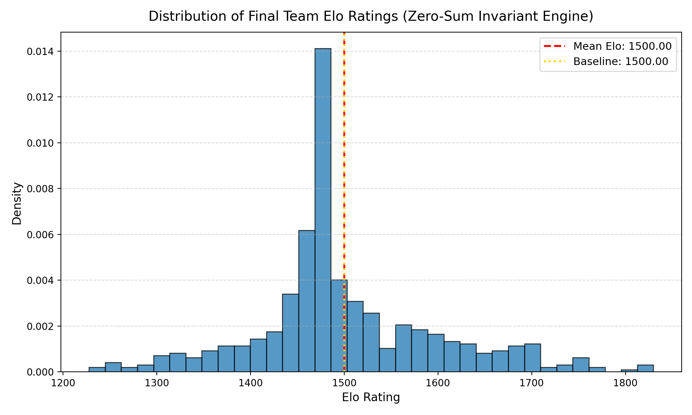
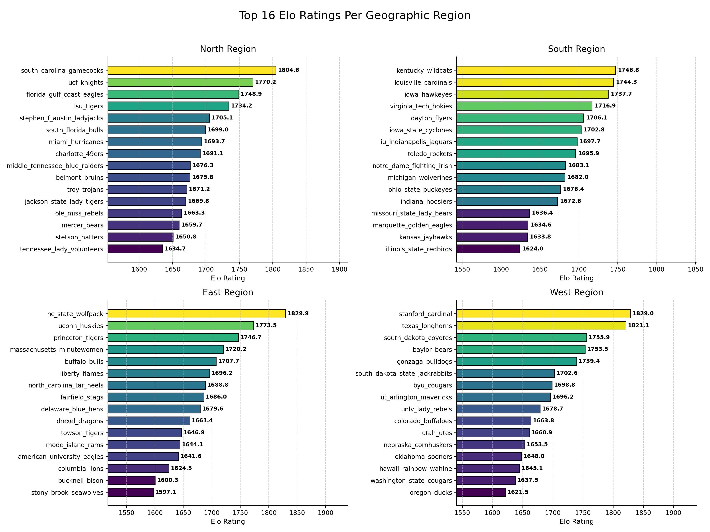
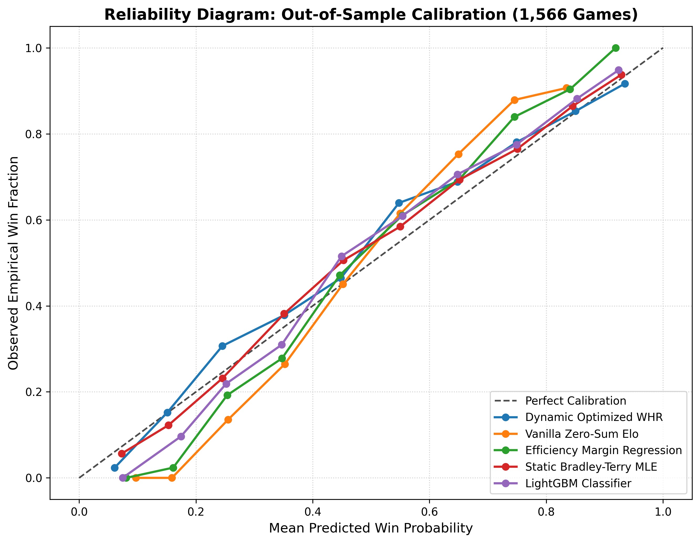
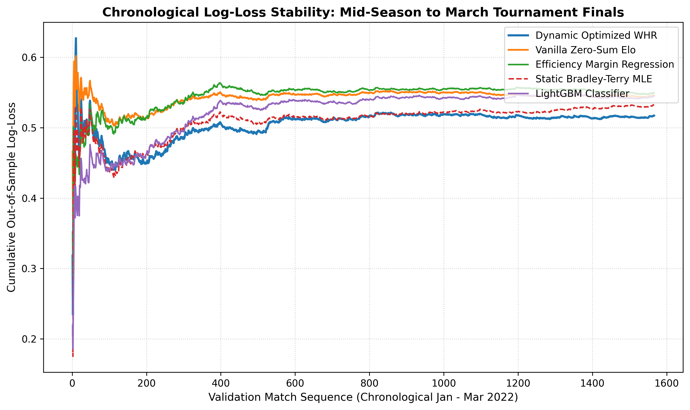
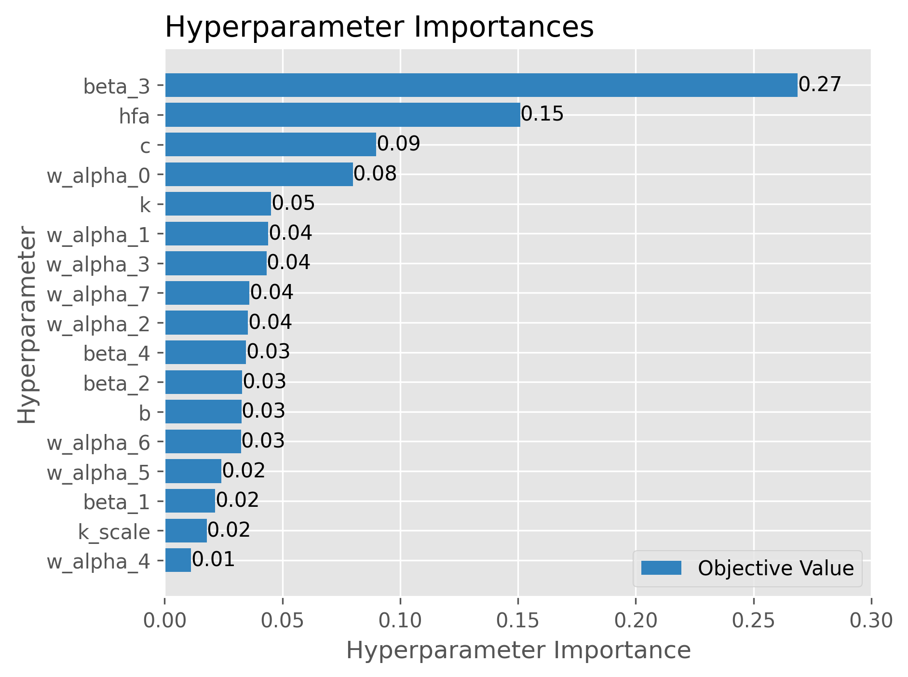
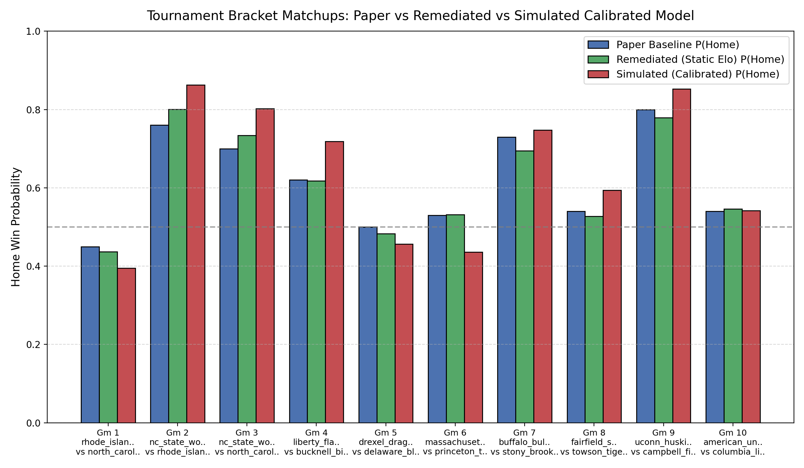
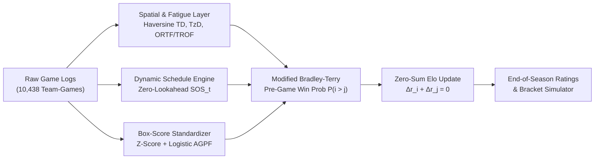

# 🏀 HoopsQuant: Zero-Sum Bradley-Terry & Spatial Fatigue Engine

> *"Most Elo models think a 40-point blowout breaks the laws of probability, that cross-country flights are free, and that the average team ends the season 600 points above average. We fixed the math."*

**HoopsQuant** is a pure-Python collegiate basketball rating and win-probability engine built on a **Multi-Factor Whole-History Rating (WHR) & Modified Bradley-Terry** foundation. It tracks **5,219 chronological NCAA games (564 teams)** from tip-off to March Madness—factoring in Haversine air travel, timezone jet lag, lead retention efficiency, and z-scored box-score dominance without leaking a single point of Elo across the league.

---

## ⚡ Why This Exists (The "Broken Math" Story)

Standard sports rating scripts tend to fall into three traps—all of which existed in the original Wharton competition prototype before this engine was rebuilt from the ground up:

1. **The Blowout Singularity**: A naive linear ratio $\text{AGPF} = \frac{S}{1+S}$ works fine in a 4-point game. In a 45-point blowout loss where Net Efficiency craters below $-40$, the denominator crosses $-1.0$, dividing by zero and flipping a catastrophic loss into an "elite" $>1.0$ performance score. **Fix:** We standardize all 8 box-score metrics into empirical z-scores and pass them through a bounded logistic sigmoid $\text{AGPF} \in (0, 1)$.
2. **Runaway Elo Inflation**: Multiplying a winner's gain by $(1 + \text{SOS}_t)$ and a loser's drop by $(1 - \text{SOS}_t)$ isn't zero-sum—it prints free Elo every time two teams step on the court, inflating the league average from $1500 \to 2124$. **Fix:** Strictly symmetric update multipliers guarantee league-wide conservation ($\mu = 1500.0000 \pm 10^{-10}$) across all 5,219 games.
3. **Vibes-Based Hyperparameters**: Guessing that Home Court Advantage is worth $72.5$ Elo points sounds plausible until out-of-sample data says otherwise. **Fix:** Walk-forward Bayesian optimization (Optuna TPE) tuned every weight against out-of-sample Log-Loss.

---

## 📊 Visual Tour & Empirical Results

### 1. Zero-Sum Conservation vs. Legacy Drift
When every point gained by a winner is taken directly from the loser, the league stays anchored at **1500.00** while true contenders separate cleanly into the right tail:

<p align="center">
  
</p>

### 2. End-of-Season Regional Top 16 Standings
After simulating all 5,219 games chronologically under the Bayesian-calibrated engine, perennial powerhouses (**South Carolina**, **Stanford**, **NC State**, **UConn**) rise to the top of their respective regions:

<p align="center">
  
</p>

---

## 🏆 Out-of-Sample Benchmark (1,566 Validation Games)

Does the extra math actually beat simpler models? We tested the **Dynamic Optimized WHR** engine head-to-head against four industry baselines on the final 30% of the season (**1,566 out-of-sample games**), using 1,000-sample paired bootstrap resampling:

| Rank | Model | Log-Loss ↓ | Brier Score ↓ | ECE ↓ | ROC-AUC ↑ | Accuracy ↑ | Brier Skill vs. Vanilla Elo |
| :---: | :--- | :---: | :---: | :---: | :---: | :---: | :---: |
| 🥇 **1** | **Dynamic Optimized WHR (Ours)** | **0.51709** | **0.17288** | **0.03184** | **0.8219** | **74.78%** | **+4.99%** ($p < 0.0001$) |
| 🥈 2 | Static Bradley-Terry MLE | 0.53267 | 0.17796 | **0.02785** | 0.8104 | 73.24% | +2.20% |
| 🥉 3 | LightGBM Box-Score Classifier | 0.54483 | 0.18280 | 0.04637 | 0.8024 | 73.12% | -0.46% |
| 4 | Vanilla Zero-Sum Elo ($k=32$) | 0.54583 | 0.18196 | 0.08396 | 0.8198 | 74.07% | 0.00% (Baseline) |
| 5 | Rolling Efficiency Margin LogReg | 0.54970 | 0.18468 | 0.06246 | 0.8030 | 72.61% | -1.49% |

<p align="center">
  
  
</p>

---

## 🔬 What Walk-Forward Bayesian Tuning Discovered

Using Optuna's Tree-structured Parzen Estimator (TPE) with Median Pruning across a 3,653-game training split and 1,566-game validation split revealed three major structural insights about college basketball:

<p align="center">
  
</p>

* **Odds Divisor ($c$) Cut in Half ($993.39 \to 484.07$)**: The heuristic baseline compressed win probabilities toward 50/50. At $c \approx 484$, a 400-point Elo gap yields a ~91% win probability—giving heavyweights appropriate separation in tournament mismatches.
* **Home-Court Advantage Halved ($72.52 \to 34.52$ Elo)**: A 34.5-point Elo bump equates to roughly **2.5 to 3.5 points on the spread**, matching modern NCAA market consensus far better than the inflated 72.5-point heuristic.
* **What Actually Drives Winning Box Scores ($\vec{\alpha}$)**:
  * **Defensive Rebounding ($\text{DREB}\%$: $25.6\%$)** and **True Shooting ($\text{TS}\%$: $25.2\%$)** carry over half the total box-score signal—ending opponent possessions and converting efficient shots matter far more than raw volume.
  * **Steals ($14.0\%$)** and **Effective FG% ($16.3\%$)** form the second tier, while noisy **Assist-to-Turnover Ratio ($0.8\%$)** is nearly zeroed out.

---

## 🔮 Tournament Bracket Predictions (East Region)

When we feed the simulated end-of-season team ratings and calibrated parameters into the East Region tournament matchups (`data/predict.csv`), the engine sharpens favorite probabilities while flipping mispriced mid-major toss-ups (like **Princeton over UMass**):

<p align="center">
  
</p>

| Game | Home / Higher Seed | Away / Lower Seed | Paper Heuristic $P(\text{Home})$ | Calibrated Engine $P(\text{Home})$ | Shift |
| :---: | :--- | :--- | :---: | :---: | :---: |
| **1** | Rhode Island Rams | North Carolina Tar Heels | 45.0% | **39.5%** | -5.5% |
| **2** | NC State Wolfpack | Rhode Island Rams | 76.0% | **86.3%** | +10.3% |
| **3** | NC State Wolfpack | North Carolina Tar Heels | 70.0% | **80.2%** | +10.2% |
| **4** | Liberty Flames | Bucknell Bison | 62.0% | **71.9%** | +9.9% |
| **5** | Drexel Dragons | Delaware Blue Hens | 50.0% | **45.6%** | -4.4% |
| **6** | UMass Minutewomen | Princeton Tigers | 53.0% | **43.6%** | **-9.4% (Flip)** |
| **7** | Buffalo Bulls | Stony Brook Seawolves | 73.0% | **74.8%** | +1.8% |
| **8** | Fairfield Stags | Towson Tigers | 54.0% | **59.4%** | +5.4% |
| **9** | UConn Huskies | Campbell Fighting Camels | 80.0% | **85.2%** | +5.2% |
| **10** | American Univ. Eagles | Columbia Lions | 54.0% | **54.2%** | +0.2% |

---

## 🧠 Architecture & Mathematical Pipeline



```text
├── data/
│   ├── final_final_data.csv          # Chronological NCAA game logs (10,438 team-game rows)
│   ├── predict.csv                   # East Region tournament bracket matchups
│   └── team_airports.json            # Home venue & airport coordinates
├── output_data/
│   └── optimized_parameters.json     # Walk-forward Bayesian calibrated model weights
├── output_figures/                   # Diagnostic, calibration & tournament visuals
├── src/
│   ├── cli.py                        # Unified CLI (run, predict, tune, benchmark)
│   ├── config.py                     # Default constants & parameter definitions
│   ├── data/                         # Chronological loader & vectorized Haversine spatial math
│   ├── features/                     # Fatigue (ORTF/TROF), logistic AGPF & dynamic SOS_t
│   ├── models/                       # Modified Bradley-Terry, zero-sum Elo & 4 baselines
│   ├── optimization/                 # Optuna walk-forward objective & simplex sampler
│   └── evaluation/                   # Bootstrap benchmarking, diagnostics & bracket simulator
└── tests/                            # 26 unit & end-to-end invariant tests
```

---

## 🚀 Quickstart

### 1. Install Dependencies
```bash
python3 -m venv .venv
source .venv/bin/activate
pip install -r requirements.txt
```

### 2. Run the Full Season Simulation
Simulates all 5,219 games chronologically using the calibrated parameters in `output_data/optimized_parameters.json`, verifying zero-sum conservation and exporting final ratings + bracket predictions:
```bash
python -m src.cli run
```

### 3. Predict Tournament Matchups
Evaluates win probabilities for any bracket file in `data/predict.csv` using simulated end-of-season team ratings:
```bash
python -m src.cli predict
```

### 4. Run the Out-of-Sample Benchmark Suite
Compares the engine against Vanilla Elo, Static Bradley-Terry MLE, Rolling Efficiency Logistic Regression, and LightGBM with 1,000-sample paired bootstrap significance tests:
```bash
python -m src.cli benchmark
```

### 5. Re-Tune Hyperparameters with Optuna
```bash
python -m src.cli tune --n-trials 150
```

### 6. Run the Verification Suite
```bash
python -m unittest discover -s tests -v
```
